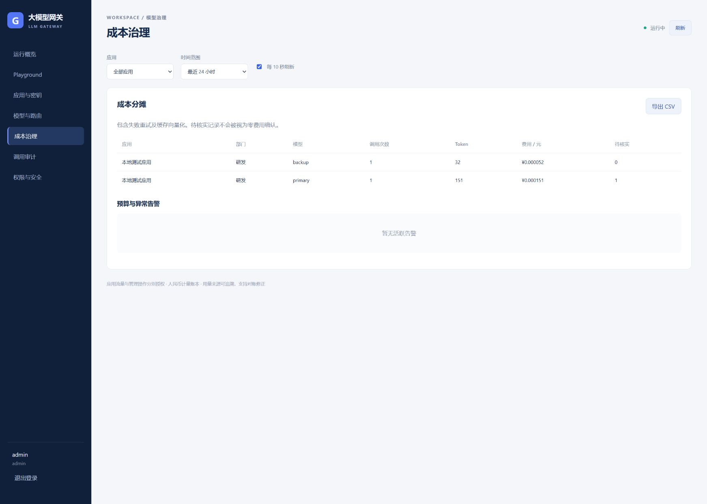

# 企业大模型网关

Go 数据面、管理面、计量 worker 与 React 控制台。按已确认的 [需求规格](docs/spec.md) 和 [技术方案](docs/design.md) 实现，首批接入 DeepSeek、Qwen、OpenAI 的 OpenAI 兼容接口。真实模型名称、能力、价格及 Qwen 地域通过控制台配置。

支持文本 Chat、SSE、工具调用透传、结构化输出、Embedding、文本 Rerank、应用密钥与 RBAC、显式路由、降级与熔断、全局配额、预算预占、语义缓存、幂等计量、成本报表、灰度回滚和安全审计。

文本重排接口为 `POST /v1/rerank`（亦支持 `/v1/reranks`），统一输入查询和候选文档，兼容百炼兼容接口与 DashScope 文本排序接口。配置方法、请求示例及计量边界见 [重排规格](docs/rerank-spec.md)。

控制台“模型资源与默认路由”提供已保存模型列表、新增、编辑和删除操作，引用中的模型需先调整路由或缓存配置。管理 API 的 `POST /admin/models` 仅新增，修改改用 `PUT /admin/models/{id}`；详见 [模型资源管理规格及验证结果](docs/model-resource-management-spec.md)。

厂商凭据使用“已保存厂商”列表，新增必填 API Key，编辑留空保留原密钥。`POST /admin/providers` 仅新增，修改使用 `PUT /admin/providers/{id}`；详见 [厂商凭据管理规格](docs/provider-resource-management-spec.md)。

## 本地运行

需要 Go 1.27、Node.js 24。Windows PowerShell：

```powershell
./scripts/dev.ps1
```

打开 <http://127.0.0.1:8081>，账号 `admin`。启动终端显示一次性管理员密码及应用 API Key；可在启动前通过 `GW_ADMIN_PASSWORD` 指定 12–72 字节密码。网关地址为 <http://127.0.0.1:8080/v1>。

离线模式使用内存和确定性模拟上游，重启清空数据，不调用真实厂商。Playground 使用终端的应用 Key。`[fail-primary]` 模拟主模型故障；`[break-stream]` 模拟流式中断。

修改前端时可在 `web` 目录执行 `npm run dev`，使用 Vite 代理；后端管理 Origin 按访问地址校验。构建结果由管理服务直接托管。

默认端口已被占用时，可手动启动：

```powershell
$env:GW_GATEWAY_ADDR='127.0.0.1:18080'
$env:GW_ADMIN_ADDR='127.0.0.1:18081'
go run ./cmd/dev
```

已安装 Docker 时也可执行 `docker compose up --build`，保持离线运行方式。

## 部署与验证

- [阿里云 2 核 4 GiB 个人部署指南](docs/lite-deployment.md)：域名、备案、SSH、构建、初始化及 HTTPS；关闭语义缓存，规格需按验收报告确认。
- [低配验收报告](docs/lite-deployment-report.md)：真实依赖、资源限额、故障恢复和未验证项。
- [部署说明](docs/deployment.md)：容器联调、云 Kubernetes、Secrets、健康检查、SSE、升级与回滚。
- [运维说明](docs/operations.md)：计量对账、配额恢复、缓存、告警及数据保留。
- [验证报告](docs/validation.md)：已执行的回归与尚未执行的基础设施、真实厂商和压测项目。

```powershell
./scripts/verify.ps1
```

GitHub Actions 配置包含 Linux race 测试、构建与 Docker 镜像构建。当前尚未推送代码，CI 未执行。Go 并发测试与 miniredis Lua 回归不替代真实 Redis/MySQL/Kafka/etcd/Milvus 联调。

## 接口行为

应用 Key 只展示一次；厂商凭据以 AES-GCM 加密。管理员账号与应用 Key 分开授权。写操作要求 Cookie、Origin 和 CSRF，生产 Cookie 要求 HTTPS。开发者仅查看本人应用，成本角色不能查看采样正文。

一次客户端调用对应 `request_id`；每次推理或缓存向量化对应 `attempt_id`。计量记录包含模型、价格版本、用量来源和修正版本。费用以人民币整数微单位记录（1 元 = 1,000,000 微单位），单价按每百万 Token 输入。

厂商 usage 缺失时显示估算且进入待核实；缓存命中返回 usage=0，但本次内部向量化费用仍进入账本。缓存默认关闭，使用 `X-Gateway-Realtime: true` 或 `X-Gateway-Cache: bypass` 可显式跳过。

配置保存后发布版本；发布失败会显示待生效，并保留新签发的一次性 Key。密钥吊销后，数据面在 3 秒内同步；配置失联超过 3 秒拒绝鉴权。流式响应开始后禁止降级混入其他模型输出。

控制台应用调用监控支持最近 24 小时内任意区间，展示成功 QPS、按 HTTP 状态码和业务错误码拆分的失败 QPS、QPS 上限及趋势。需配置 `GW_PROMETHEUS_URL`；未接入或缺失采样时明确显示无数据。其他概览统计采用最近记录样本；容量和分位数使用 [Grafana 监控](deploy/observability/dashboard.json)。万级并发和延迟目标尚未完成容量验收。


