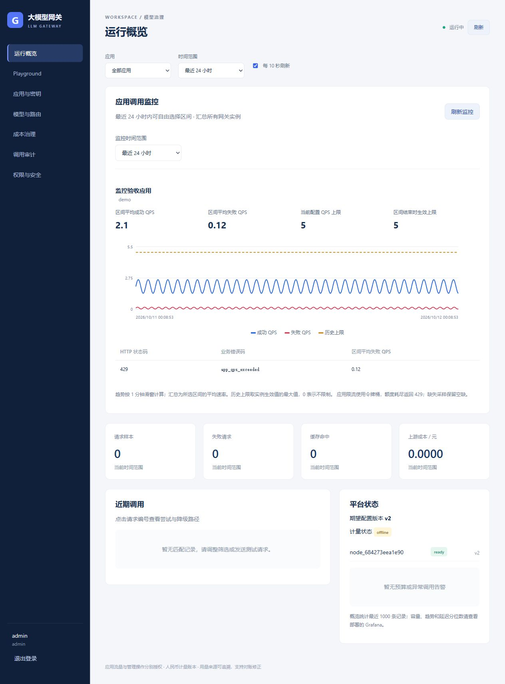

# 应用调用监控验证记录

2026-10-12，Windows 本地验证。规格见 [app-traffic-spec.md](app-traffic-spec.md)。

## 已通过

- 全量 `go test ./... -count=1`；监控专项 `go test -p 1 ./internal/gateway -run TestApplication -count=1`。覆盖客户端只计数一次、Chat/Embedding/Rerank、早期拒绝、429 应用限流、SSE HTTP 200 失败及客户端业务错误码、过载时不读取正文。
- 查询测试使用本机模拟 Prometheus，验证权限隔离、应用标签转义、多实例及共享注册表去重表达式、任意历史区间、24 小时边界、毫秒时间点、无数据、故障和非法/部分/超大结果。
- `go vet -p 1 ./...`、`go build -p 1 ./...`。首次默认并行构建因主机无法分配内存中断；降低构建并行度后通过。
- `npm run build`、`npm test`（7 项）、Prettier 格式检查。覆盖时间范围校验、缺失采样断线、0 表示不限制、查询取消及参数编码。
- 部署静态校验：29 个 YAML 文档、38 个监控面板；轻量部署管理接口并发上限为 8。
- 浏览器使用隔离的本机管理服务与模拟 Prometheus，确认登录、24 小时范围、成功/失败/上限图表、错误码表、自定义控件及默认自定义区间查询正常。截图为验收数据，不代表真实应用流量。

## 验证边界

- 浏览器工具修改 `datetime-local` 输入未成功；任意区间及越界拒绝由前后端自动化测试覆盖，浏览器本次仅验证默认自定义区间查询。
- 真实 Prometheus/Grafana 容器联调未执行。拉取官方 Prometheus 镜像时 Docker Hub 连接返回 EOF，本次未把模拟服务结果当作真实 PromQL 执行验证。
- 未部署现有实例，未调用真实百炼模型，未推送远端。配置及代码变更需重新构建并重启对应服务后生效；监控历史只包含新增指标上线后的采样。

代码和测试结果交由用户按项目流程人工验收。

## 阿里云实机验证补充（2026-10-12）

本记录上方保留首次代码交付时的验证范围。用户随后授权部署，已在 ECS 启用私有 Prometheus，真实 promtool 配置与规则检查、最近 24 小时和自定义历史区间的实际 PromQL 查询、25 小时区间拒绝、HTTPS 登录和浏览器展示均通过。另补充了全天低 QPS 不得显示为零的回归测试，前端现为 8 项测试。详见 [部署记录](cloud-app-traffic-deployment.md)。
