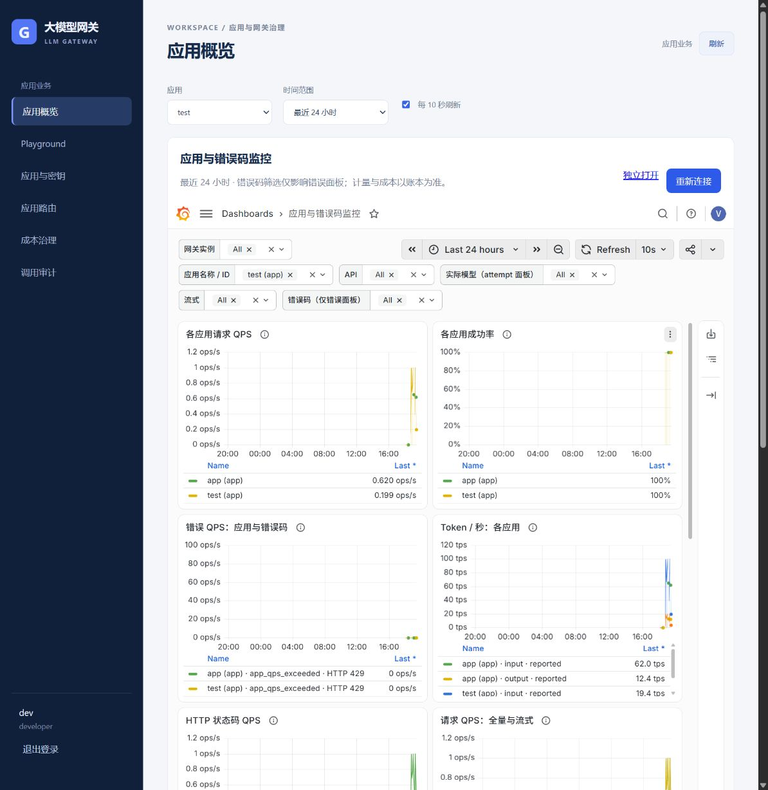
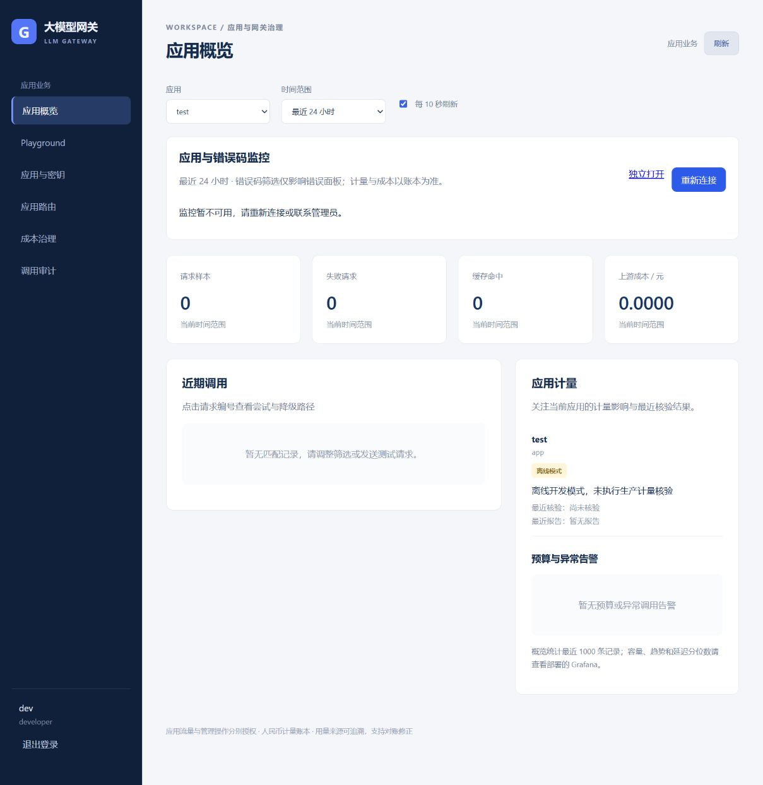

# Grafana 应用隔离与控制台嵌入验收

日期：2026-10-14。对应规格：[grafana-console-monitoring-spec.md](grafana-console-monitoring-spec.md)。
状态：本地实现和验证完成，代码与测试结果待人工验收；尚未创建新 PR、尚未变更云端。

## 交付内容

- 管理员完整可靠性仪表盘 36 个面板；developer/cost 应用仪表盘 13 个面板。新增应用请求 QPS、成功率、错误码/HTTP 状态、Token 视图；成功率分母包含所有请求，不被错误码筛选缩小。
- 控制台用同源 Grafana iframe 替换旧手绘曲线，无二次 Grafana 登录。保留计量、成本、近期调用与审计；删除 TrafficPanel、traffic.ts、app-traffic API/服务及其废弃测试与样式。
- developer 的权限由当前用户及 app.Owner 决定。每个 PromQL 输入选择器强制取自有应用交集，固定业务指标和 Prometheus 数据源；所有查询、标签枚举、仪表盘 DTO 和搜索均不能绕过范围。cost 沿用全局应用数据权限，admin 可查看全局可靠性指标。
- 凭据仅在服务端使用专用 Viewer；客户端身份、Cookie 与上游 Set-Cookie 不透传。只读路由白名单、同源 POST、编码路径检查和重定向阻断覆盖实际 Grafana 13 新 DTO 接口。
- 代理独立总并发 24、查询并发 4、有界排队 2 秒。查询窗口最多最近 24 小时，最多 16 条表达式/请求，最多 1500 点，最小步长 10 秒。静态资源流式传输，支持 gzip 和授权后的私有缓存；动态响应不缓存。
- 配置/重连可用性预检最长 2 秒。Grafana 停机时显示明确提示，其它管理读取继续可用；SQL、Redis 预算预占、Prepare/Arm、计量恢复、未知费用、Outbox/GC 均未改动，无业务 DDL。

## 验证证据

| 验证 | 结果 |
| --- | --- |
| Linux Go 1.27 完整 `go test -race -p 1 ./...` | 通过 |
| Linux `go vet ./...`、`go build ./...` | 通过 |
| 前端生产构建、12 项保留测试、Prettier | 通过 |
| 部署结构校验 | 32 个 YAML 文档通过 |
| Prometheus 3.5.0 promtool | 两份仪表盘共 67 条表达式、14 条告警及短租约回归通过 |
| Grafana 13.2.3 + Prometheus 真实集成 | 专用 Viewer HTML、资源、DTO 和所有面板查询通过 |
| 两个不同 Owner 的应用 | developer 成功请求合计 123；admin/cost 合计 1122，foreign app 查询与标签枚举不泄漏 |
| 权限及绕行回归 | 空应用、应用转移、注销、全局仪表盘、其它数据源、__expr__、全局指标、裸选择器、嵌套查询、元数据、任意 /apis、后端 ad hoc 重写字段均验证 |
| 代理资源/故障边界 | 管理并发独立、满槽拒绝、断连槽位释放、伪造 Cookie/身份头、gzip 与外部跳转阻断通过 |
| 浏览器故障注入 | 仅停止本地 Grafana，重连显示不可用；刷新仍可读应用、计量与成本区域 |

真实集成用显式环境变量启动 `TestGrafanaRealIntegration`，普通测试默认跳过外部依赖。测试账户和业务数据均为隔离环境的合成数据，不访问真实模型。浏览器阶段直接生成指标来验证展示，没有执行持续负载，也没有新增最大吞吐、长期容量或真实模型时延结论。图中同一 app 的历史信息缺失时回退为 ID，保留历史采样。

## 远端发布与验收（2026-10-14）

- 代码与测试结果已由用户验收通过；新 PR 为 [#10](https://github.com/zjqylhy/llm_gateway/pull/10)，保持未合并。发布前两项 GitHub verify 检查均通过。
- 远端运行代码提交 `86a46f6a1a9a9c2bab06ad66f23e605f956d12db`，业务镜像 `llm-gateway:grafana-console-20261014-86a46f6`，镜像 ID `sha256:26aa62951ef291f8d4dd7a92ca5bd740bd856f696546874548b347ae4a42882e`。前端入口为 `index-BZtfgY8d.js`，使用干净 distroless 基础镜像，未叠加旧前端资源。
- 切换前关闭入口、停止 gateway/admin，排空旧 worker 的 Outbox 与补偿队列后停止 worker；保存 SQL 逻辑备份、配置文件与停机 Grafana 数据备份。没有业务 DDL，没有重建配额或清理 MySQL/Redis/Kafka/etcd 数据卷。
- 开放前逐项核对：财务汇总、业务配置版本及内容 hash、Kafka 来源身份、计量检查点位置/锚点均与切换前一致。worker/gateway/admin readyz、计量 healthy、permit_valid、Outbox=0 均通过；Prometheus 3 个目标 up，14 条告警保留。
- Grafana 13.2.3 保持私有，512MiB/1 CPU，配置控制台 HTTPS 子路径 `/admin/grafana/`、嵌入和 gzip；创建专用 Viewer 账号并核实其组织角色。浏览器 HTML 不含 Viewer 密码和 Basic 凭据。维护隧道使用 `http://localhost:13000/admin/grafana/`；通过控制台免二次登录。
- HTTPS 验收使用受信任本地 CA：匿名请求 401、管理员登录/注销、两份仪表盘 36/13 个面板、敏感 Grafana 路由 403、同源嵌入均通过。实际浏览器验证控制台 1 小时时间范围与 iframe 联动，以及应用/错误码筛选与正常渲染。
- 使用已有测试应用发送一次未授权模型名称请求，得到 `model_not_allowed / HTTP 403`；对应应用错误指标已通过真实 Grafana 查询与图例验证。没有调用真实模型，没有增加付费账本记录，业务配置版本保持不变。
- 用户已登录已有 developer 账号，补做远端真实浏览器验收：控制台应用列表和 Grafana 应用变量只列自有的 1 个应用，专用应用仪表盘 13 个面板正常渲染，无需二次 Grafana 登录。URL 设置 `var-app=$__all`、24 小时时间范围后，实际 Token 序列仍仅来自该自有应用；将变量篡改为另一应用 ID 后，同一时间范围的可见面板无返回数据。恢复原控制台筛选，保留用户真实会话；未伪造会话、修改用户/Owner/配置或调用模型。
- 本地两个 Owner、真实 Grafana/Prometheus 集成及接口权限回归仍是完整 PromQL/元数据/数据源绕行的证据。远端内置浏览器拦截直接打开 JSON 资源接口及被拒绝页面，未取得其服务端 HTTP 状态，不能把客户端拦截写成服务端 403，也不把未完成的搜索界面验证写成通过。
- 开发者界面部分 QPS/成功率面板为 N/A，表示没有适用的时序数据；历史 Token 曲线可见。N/A 不作为请求数为零、成功率或性能结论。真实生产截图仅本机留存，不上传公开仓库。

### 发布故障与恢复

首次切换因 Windows 打包没有保留 Linux 二进制执行位而无法启动容器。入口尚未开放，自动恢复旧镜像、配置与 Grafana 数据，三个角色 readyz 恢复；财务、配置和检查点核对一致。修正发布包 tar 权限为 bin=0755、其它文件=0644，并在关闭入口前校验打包文件及镜像内所有角色的执行位。第二次切换成功，切换脚本阶段耗时 33.78 秒（含备份、停止与验证，不含事先构建镜像）。这属于发布工艺问题，不是网关性能结论。

成功备份位于远端 `/opt/llm_gateway/releases/grafana-console-20261014-86a46f6/backup-attempt2`，首次回滚备份仍保留。入口重开后禁止恢复旧财务快照；此变更没有业务 DDL，可回退兼容业务镜像和监控配置并保留当前财务数据。

### 上线资源快照

| 角色 | 内存占用 / 限额 | CPU |
| --- | --- | --- |
| gateway | 8.953 / 256 MiB | 0.11% |
| admin | 10.29 / 256 MiB | 0.10% |
| worker | 11.91 / 256 MiB | 0.63% |
| Grafana | 405.3 / 512 MiB | 0.67% |
| Prometheus | 64.43 / 256 MiB | 0.00% |

这是启动后低流量的单点快照，五个角色均运行、重启 0、OOM=false。浏览器加载后第二次快照：Grafana 397.1/512 MiB、CPU 19.83%；admin 15.82/256 MiB、CPU 0.28%，仍无 OOM 或重启。这些瞬时值不能代表稳定负载容量；Grafana 内存接近 80% 限额，应继续观察。本次没有新增持续负载、长期容量或最大吞吐结论。
